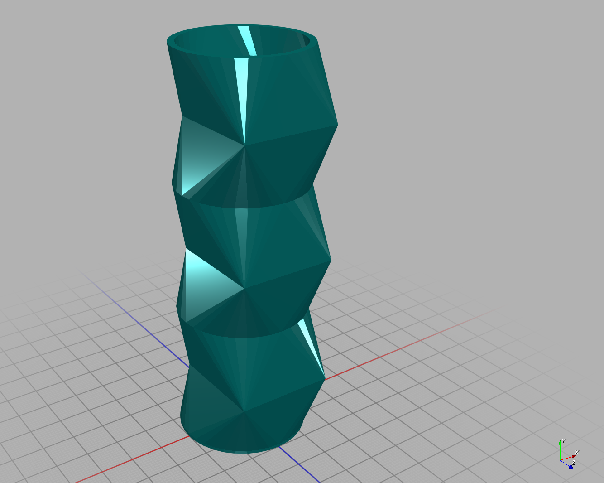

[](https://clojars.org/org.clojars.cartesiantheatrics/plexus)

# Plexus

Plexus is a simple tool for defining cross sections and extruding them in a piece-wise fashion using egocentric reference frames.

You can specify 3D models by providing a series of extrusions to a set of cross sections, which are then composited using CSG operations.

This library is built on top of [clj-manifold3d](https://github.com/SovereignShop/clj-manifold3d), a traditional CSG library in the style of OpenSCAD. 

# Try it Out

A beginner friendly introduction to developing with Plexus is available [here](https://github.com/SovereignShop/plexus-demo).


# Install

This library uses [java bindings](https://github.com/SovereignShop/manifold?tab=readme-ov-file#installation) to the native library Manifold. The platform specific dependency needs to be included separately from plexus.

## ClojureScript and SCI

The modeling API, schemas, transforms, and geometry helpers now live in `.cljc`.
Operations such as `frame`, `forward`, `branch`, `loft`, and `result` are ordinary
functions returning validated form maps. Existing call syntax, nested sequences,
`for`, threading, and CSG result trees work on both platforms. Operations can also
be passed to `map` or `apply`, and accept an options map:

```clojure
(p/extrude
  (p/frame {:name :body :cross-section (m/square 10 10 true)})
  (map p/forward [{:length 2} {:length 3}]))
```

The published `clj-manifold3d` 1.1.1 dependency remains the JVM default. For JS,
use the sibling checkout's JS/WASM bindings (the `:cljs` development alias does
this automatically), or a release containing that API:

```clojure
org.clojars.cartesiantheatrics/clj-manifold3d {:local/root "../clj-manifold3d"}
```

Initialize the WASM backend once before modeling. In a browser, load
`clj-manifold3d/public/wasm/manifold.js`, serve its matching `manifold.wasm`, and:

```clojure
(require '[clj-manifold3d.core :as m] '[plexus.core :as p])

(-> (m/init! {:wasm-url "/wasm/manifold.wasm"})
    (.then (fn [_]
             (p/extrude
               (p/frame :name :body :cross-section (m/square 10 10))
               (p/forward :length 5)))))
```

Node hosts can pass an Emscripten `:factory` and `:wasm-binary` to `m/init!`;
see `test/cljs/plexus/test_runner.cljs`. Modeling is synchronous after initialization.
JS geometry owns WASM resources: use `m/dispose!` when finished, or
`m/with-disposal` around a synchronous computation that returns only copied data.
Use `p/get-model` to pass an extrusion's geometry to the JS Manifold API.
`export` delegates to the backend; formats, return values, and asynchronous I/O
follow that backend. `export-models` (namespace scanning and JVM filesystem I/O)
is JVM-only. The optional `defmodel` convenience macro is JVM-only; portable
code uses `(def name (p/extrude ...))`.

SCI support is opt-in. Add `org.babashka/sci` (tested with `0.10.49`) and compile
`plexus.sci` into your host. No Plexus operation macros or JVM classes need to be
exposed to the interpreter:

```clojure
(require '[sci.core :as sci]
         '[plexus.sci :as ps]
         '[clj-manifold3d.core :as m])

;; Initialize WASM first in a JS host. Expose the geometry functions you need.
(def ctx
  (sci/init
    (assoc-in ps/config [:namespaces 'clj-manifold3d.core]
              {'square m/square})))

(sci/eval-string* ctx
  "(require '[plexus.core :as p] '[clj-manifold3d.core :as m])
   (p/extrude
     (p/frame :name :body :cross-section (m/square 10 10))
     (for [i (range 3)] (p/forward :length 2)))")
```

This is a compiled host integration using SCI's
[namespace copying API](https://github.com/babashka/sci/blob/master/API.md#copy-ns),
not a promise that all implementation source can be loaded directly into a bare
SCI/nbb environment. Normal Plexus use does not require SCI.

## Rebuilding and evaluation

Function arguments are evaluated once at form construction. Previously the
operation macros evaluated them during validation and again during execution,
and captured implicit thunks for `rebuild`. To rebuild with fresh values, defer
those forms explicitly. This works with dynamic bindings, atoms, and SCI:

```clojure
(def length (atom 5))
(def model
  (p/extrude
    (p/frame :name :body :cross-section (m/square 2 2))
    (p/deferred #(p/forward :length @length))))

(reset! length 10)
(p/rebuild model)
```

A deferred function may return a single form, nested sequences, or nil. Wrap an
entire `for` in `deferred` to regenerate its sequence on every build. Ordinary
forms retain their captured values. This explicit thunk is the one syntax change
needed for implicit re-evaluation: ordinary functions cannot capture unevaluated
arguments. Applications that invoked the internal callable `Form` objects should
instead treat forms as data; the internal `Form` type and `defop` macro are removed.

## Validation without operation macros

Malli validates options when each operation is constructed, including inside SCI.
Failures carry the operation and form in `ex-data`. This preserves the runtime
checks the old macros emitted; those macros did not statically validate values.

Exported [clj-kondo hooks](https://github.com/clj-kondo/clj-kondo/blob/master/doc/hooks.md)
add editor/CI checks without changing the runtime API. They catch missing required
options, missing keyword values, conflicting `forward` axes, and invalid literal
numbers, names, normals, step counts, and enum values. Import the library's config
with clj-kondo's normal dependency scan (`clj-kondo --lint "$(clojure -Spath)" --dependencies --copy-configs`).
For this checkout, the hook directory can be used directly:

```sh
clj-kondo --lint your-model.clj \
  --config-dir resources/clj-kondo.exports/org.clojars.cartesiantheatrics/plexus
```

The hooks leave ordinary symbol analysis intact and do not execute model code.
Computed options maps and nonliteral values still need runtime validation; the
hooks are not a general type checker. Open-ended defaults and metadata remain
supported. Runtime validation no longer has macro call-site metadata; attach
metadata to form maps when needed, or use the linter for source locations.

## Development checks

```sh
clojure -M:dev:test                 # Published JVM dependencies
clojure -M:dev:test:sci             # Also test interpreted models
clojure -M:local-dev:test:sci       # Sibling bindings and local native jar
clojure -M:cljs -m shadow.cljs.devtools.cli release test
node target/cljs-tests.js          # Real WASM geometry and SCI, advanced compilation
python3 scripts/test-lint.py       # Requires clj-kondo on PATH
```

The JS runner loads the sibling checkout's `public/wasm/manifold.js` and matching
WASM binary. Shared tests cover CSG, branches, all four curves, gaps, loft sampling,
hulls, insertion, targeting, points, transforms, validation, and deferred rebuilding.
The existing JVM tests, including the forward sampling regressions, remain enabled.

# Projects Using Plexus

A Simple rapidly printable hydroponic tower:
https://github.com/SovereignShop/spiralized-hydroponic-tower

Kossel delta printer:
https://github.com/SovereignShop/kossel-printer/


# Examples

In the following example, our outer cross section is a circle with radius of 6. The mask
cross section is a circle of radius 4. We then specify a series of egocentric transformations to the
outer and inner cross sections. 

``` clojure
(require
 '[clj-manifold3d.core :as m]
 '[plexus.core
   :refer [result frame left right forward up down hull extrude set branch
           rotate translate difference union intersection points export insert
           loft trim-by-plane offset]])

(-> (extrude
     (result :name :pipes
             :expr (difference :body :mask))

     (frame :cross-section (m/circle 6) :name :body)
     (frame :cross-section (m/circle 4) :name :mask)
     (set :curve-radius 20 :to [:body]) (set :curve-radius 20 :to [:mask])

     (left :angle (/ Math/PI 2) :to [:body])
     (left :angle (/ Math/PI 2) :to [:mask])

     (right :angle (/ Math/PI 2) :to [:body])
     (right :angle (/ Math/PI 2) :to [:mask])

     (forward :length 10 :to [:body])
     (forward :length 10 :to [:mask])

     (up :angle (/ Math/PI 2) :to [:body])
     (up :angle (/ Math/PI 2) :to [:mask]))
    (export "test.glb"))
```

Obviously there is a lot of code duplication here. After providing the cross section for the inner and outer forms,
the transformations we apply to each are equivalent. We can get rid of that duplication by only providing one 
transforming both cross sections with each segment:

``` clojure
(-> (extrude
     (result :name :pipes
             :expr (difference :body :mask))

     (frame :cross-section (m/circle 6) :name :body)
     (frame :cross-section (m/circle 4) :name :mask)
     (set :curve-radius 20 :to [:body :mask])

     (left :angle (/ Math/PI 2) :to [:body :mask])
     (right :angle (/ Math/PI 2) :to [:body :mask])
     (forward :length 10 :to [:body :mask])
     (up :angle (/ Math/PI 2) :to [:body :mask]))
    (export "pipes.glb"))
```


This is equivalent to the one above, but we can still see there is a lot of duplication. The `:to [:outer :inner]` is repeated in each segment.
We can elide this, as by default each segment will reply to every frame you have defined:

``` clojure
(-> (extrude
     (result :name :pipes
             :expr (difference :body :mask))

     (frame :cross-section (m/circle 6) :name :body)
     (frame :cross-section (m/circle 4) :name :mask)
     (set :curve-radius 20)

     (left :angle (/ Math/PI 2))
     (right :angle (/ Math/PI 2))
     (forward :length 10)
     (up :angle (/ Math/PI 2)))
    (export "pipes.glb"))
```

This extrude is equivalent to the one above.

## Hulls

Hulls are often a great way to transform between cross sections. You can wrap any sequence of extrusions
in a hull form to make a convex hull out of those segments:

``` clojure
(-> (extrude
     (result :name :pipes
             :expr (difference :body :mask))

     (frame :cross-section (m/circle 6) :name :body)
     (frame :cross-section (m/circle 4) :name :mask)
     (set :curve-radius 20)
     (hull
      (hull
       (forward :length 20)
       (set :cross-section (m/square 20 20 true) :to [:body])
       (set :cross-section (m/square 16 16 true) :to [:mask])
       (forward :length 20))
      (set :cross-section (m/circle 6) :to [:body])
      (set :cross-section (m/circle 4) :to [:mask])
      (forward :length 20)))
    (export "hull.glb"))
```


## Lofts

You can loft between a sequence of cross-sections with `loft`. Edges are constructed between corresponding vertices of each cross-section.

``` clojure
(-> (extrude
     (result :name :pipes :expr :body)
     (frame :cross-section (m/difference (m/circle 20) (m/circle 18)) :name :body)
     (loft
      (forward :length 1)
      (for [i (range 3)]
        [(translate :x 8)
         (forward :length 20)
         (translate :x -8)
         (forward :length 20)])))
    (export "loft.glb"))
```


Lofted sections don't need to be isomorphic.

``` clojure
(-> (extrude
     (result :name :pipes :expr :body)
     (frame :cross-section (m/difference (m/circle 20) (m/circle 18)) :name :body)
     (loft
      (forward :length 1)
      (for [i (range 3)]
        [(translate :x 8)
         (set :cross-section (m/difference (m/square 30 30 true) (m/square 26 26 true)))
         (forward :length 20)
         (translate :x -8)
         (set :cross-section (m/difference (m/circle 20) (m/circle 18)))
         (forward :length 20)])))
    (export "monomorphic-loft.glb" (m/material :color [0 0.7 0.7 1.0] :metalness 0.2)))
```



## Branching

Branches work as you'd expect.

``` clojure
(def pi|2 (/ Math/PI 2))

(-> (extrude
     (result :name :pipes
             :expr (difference :body :mask))

     (frame :cross-section (m/circle 6) :name :body)
     (frame :cross-section (m/circle 4) :name :mask)
     (set :curve-radius 10)

     (branch :from :body (left :angle pi|2) (right :angle pi|2) (forward :length 20))
     (branch :from :body (right :angle pi|2) (left :angle pi|2) (forward :length 20)))
    (export "branch.glb"))
```


The body of the branch is just another extrude. The required ":from" property determines the starting coordinate frame of the branch. There's also an optional `:with` parameter that specifies which frames to include in the branch.

``` clojure
(-> (extrude
     (result :name :pipes
             :expr (difference :body :mask))

     (frame :cross-section (m/circle 6) :name :body)
     (frame :cross-section (m/circle 4) :name :mask)
     (set :curve-radius 10)

     (branch :from :body (left :angle pi|2) (right :angle pi|2) (forward :length 20))
     (branch
      :from :body
      :with [:body]
      (right :angle pi|2)
      (left :angle pi|2)
      (forward :length 20)))
    (export "branch-with.glb" (m/material :color [0. 0.7 0.7 1.0] :metalness 0.2)))
```


Note that you can introduce new frames at any point. The starting transform of any new frame is inherited from the previously introduced frame.

## Gaps

You can make any segment a gap with the `:gap` parameter:

``` clojure
(-> (extrude
     (frame :cross-section (m/circle 6) :name :body :curve-radius 10)
     (for [i (range 3)]
       [(left :angle (/ Math/PI 2) :gap true)
        (right :angle (/ Math/PI 2))]))
    (export "gaps.glb"))
```


You can also specify which subset of active frames should be a gap by supplying a vector frame names.

``` clojure
(-> (extrude
     (frame :cross-section (m/circle 6) :name :body :curve-radius 10)
     (for [i (range 3)]
       [(left :angle (/ Math/PI 2) :gap [:body])
        (right :angle (/ Math/PI 2))]))
    (export "gaps.glb"))
```

This is equivalent to above. `:gap true` is equivalent to gapping all active frames.

## Insert

The easiest way to compose extrusions is with `insert`. 

``` clojure
(let [pipe (extrude
            (frame :cross-section (m/circle 6) :name :outer :curve-radius 10)
            (frame :cross-section (m/circle 4) :name :inner)
            (forward :length 30))]
  (-> (extrude
       (result :name :pipes
               :expr (->> (difference :pipe/outer :pipe/inner)
                          (trim-by-plane :normal [-1 0 0])
                          (translate :z 30)))
       (frame :name :origin)

       (for [i (range 4)]
         (branch
          :from :origin
          (rotate :x (* i 1/2 Math/PI))
          (insert :extrusion pipe
                  :models [:outer :inner]
                  :ns :pipe
                  :end-frame :outer))))
      (export "insert.glb" (m/material :color [0 0.7 0.7 1.0] :metalness 0.2))))
```


Here we're inserting the models `:outer` and `:inner` at four different locations. We're also namespacing the inserted models with `:pipe`. `:end-frame` specifies the frame to continue on in the next segment.

## Translate 

You can "move" without extruding using `translate`.

``` clojure
(-> (extrude
     (result :name :pipes
             :expr (difference :body :mask))

     (frame :name :body :cross-section (m/circle 6))
     (frame :name :mask :cross-section (m/circle 4))

     (forward :length 10)
     (translate :x 5 :z 10)
     (forward :length 10))
    (export "translate.glb" (m/material :color [0 0.7 0.7 1.0] :metalness 0.2)))
```


## Rotate 

You can rotate in place without extruding using `rotate`.

``` clojure
(-> (extrude
     (result :name :pipes
             :expr (difference :body :mask))

     (frame :name :body :cross-section (m/circle 6))
     (frame :name :mask :cross-section (m/circle 4))

     (forward :length 15)
     (rotate :x (/ Math/PI 2))
     (forward :length 15))
    (export "rotate.glb" (m/material :color [0 0.7 0.7 1.0] :metalness 0.2)))
```


## Result

Result expressions have been demonstrated in every example so far. As you can see, they represent an arbitrarily nested CSG expression. Result expressions can reference other results by name. the set of operations that can be appear in result expressions are: `union`, `difference`, `intersection`, `hull`, `translate`, `rotate`, `mirror`, and `trim-by-plane`.

## Points

`points` is similar to `extrude` except you use it to define 2D polygons. Here's an example of how to define a circle.

``` clojure
(-> (m/cross-section
     (points
      :axes [:x :z]
      (frame :name :origin)
      (translate :x 50)
      (left :angle (* 2 Math/PI) :curve-radius 50 :cs 20)))
    (m/extrude 1)
    (export "circle.glb"))
```


## Using Extrusions

You can access extrusion models using `get-model`.

``` clojure
(m/difference (get-model extrusion :body) 
              (get-model extrusion :mask))
```

